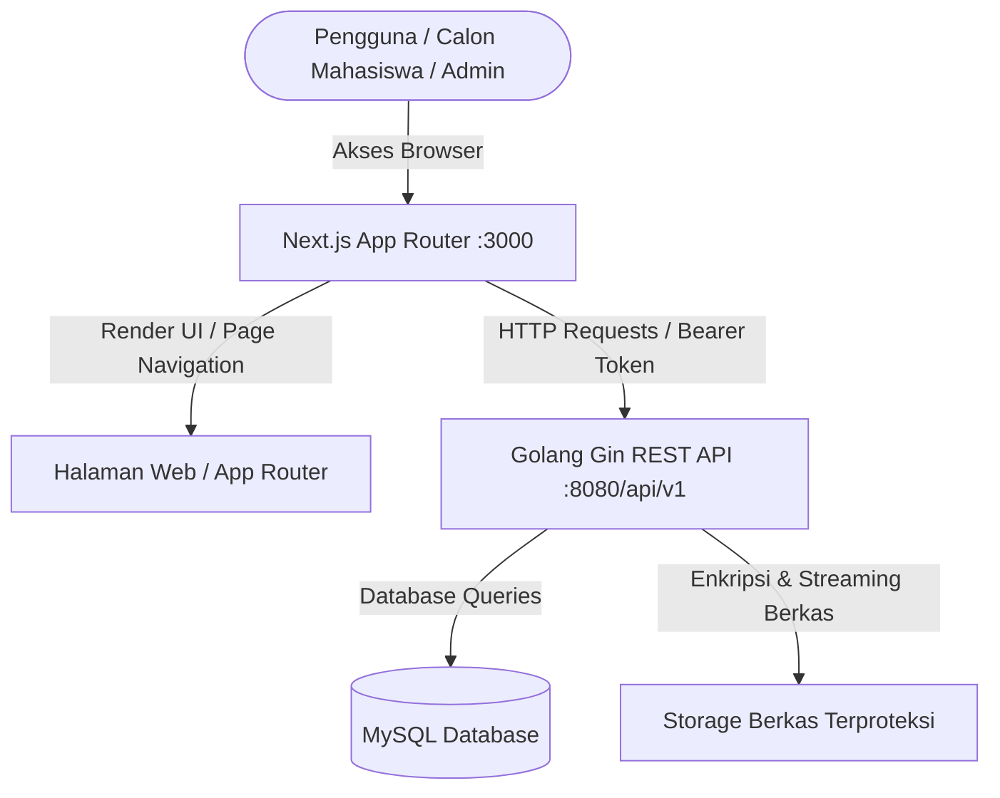

# Dokumentasi Route & REST API Endpoint
## Sistem Informasi Penerimaan Mahasiswa Baru (PMB) Terpadu
### STAI Cendekia Insani Situbondo

---

## 📌 Ringkasan Arsitektur Routing

Sistem PMB STAICI Situbondo menggunakan arsitektur **Decoupled Client-Server**:
- **Frontend App Router (Next.js 16 + React 19)**: Menangani perutean halaman web (UI), autentikasi klien, dan rendering komponen.
- **Backend REST API (Golang 1.22 + Gin Framework)**: Menangani logika bisnis, enkripsi berkas, verifikasi transaksi, autentikasi JWT, dan kontrol hak akses terpusat (RBAC).

---

## 🌐 1. Dokumentasi Route Frontend (Next.js App Router)

### 📢 A. Rute Publik & Informasi Utama
Rute yang dapat diakses oleh siapapun tanpa memerlukan proses login:

| Route URL | Lokasi File Source Code | Deskripsi & Fungsi Utama | Access Level |
| :--- | :--- | :--- | :--- |
| `/` | [`frontend/app/page.tsx`](file:///d:/Capstone%20Project/Code/frontend/app/page.tsx) | **Landing Page Utama**: Menampilkan hero banner, pengumuman PMB, profil 3 prodi unggulan (MPI, AS, KPI), dan FAQ. | Public |
| `/program-studi` | [`frontend/app/program-studi/page.tsx`](file:///d:/Capstone%20Project/Code/frontend/app/program-studi/page.tsx) | **Redirect Route**: Mengarahkan pengunjung secara otomatis ke rute prodi pertama (`/program-studi/mpi`). | Public |
| `/program-studi/[slug]` | [`frontend/app/program-studi/[slug]/page.tsx`](file:///d:/Capstone%20Project/Code/frontend/app/program-studi/%5Bslug%5D/page.tsx) | **Detail Program Studi Dinamis**: Menampilkan profil lulusan, prospek kerja, gelar akademik, dan mata kuliah unggulan (`mpi`, `as`/`hki`, `kpi`). | Public |
| `/pendaftaran` | [`frontend/app/pendaftaran/page.tsx`](file:///d:/Capstone%20Project/Code/frontend/app/pendaftaran/page.tsx) | **Informasi PMB & Alur**: Menjelaskan alur 4 langkah pendaftaran, jadwal gelombang, rincian biaya registrasi, dan syarat berkas. | Public |
| `/daftar` | [`frontend/app/daftar/page.tsx`](file:///d:/Capstone%20Project/Code/frontend/app/daftar/page.tsx) | **Redirect Route**: Shortcut URL yang otomatis mengarahkan ke `/pendaftaran`. | Public |

---

### 🔑 B. Rute Autentikasi & Akun
Rute pengolahan akun dan akses masuk ke dalam portal:

| Route URL | Lokasi File Source Code | Deskripsi & Fungsi Utama | Access Level |
| :--- | :--- | :--- | :--- |
| `/register` | [`frontend/app/register/page.tsx`](file:///d:/Capstone%20Project/Code/frontend/app/register/page.tsx) | **Registrasi Akun Calon Mahasiswa**: Form pembuatan akun baru berbasis NIK 16-digit, Nama, WhatsApp, Email, dan Password. | Guest Only |
| `/login` | [`frontend/app/login/page.tsx`](file:///d:/Capstone%20Project/Code/frontend/app/login/page.tsx) | **Portal Masuk Calon Mahasiswa**: Halaman login utama untuk calon mahasiswa baru. | Guest Only |
| `/loginadmin` | [`frontend/app/loginadmin/page.tsx`](file:///d:/Capstone%20Project/Code/frontend/app/loginadmin/page.tsx) | **Portal Masuk Admin & Panitia**: Halaman login tertutup untuk pengelola dan panitia PMB. | Guest Only |
| `/adminlogin` | [`frontend/app/adminlogin/page.tsx`](file:///d:/Capstone%20Project/Code/frontend/app/adminlogin/page.tsx) | **Alias Login Admin**: URL alternatif untuk masuk ke portal administrator. | Guest Only |
| `/lupa-password` | [`frontend/app/lupa-password/page.tsx`](file:///d:/Capstone%20Project/Code/frontend/app/lupa-password/page.tsx) | **Permintaan Reset Password**: Mengirimkan instruksi pemulihan kata sandi ke email terdaftar. | Guest Only |
| `/reset-password` | [`frontend/app/reset-password/page.tsx`](file:///d:/Capstone%20Project/Code/frontend/app/reset-password/page.tsx) | **Pembaruan Password Baru**: Halaman pengisian password baru menggunakan token verifikasi email. | Guest Only |

---

### 🎓 C. Rute Dashboard Calon Mahasiswa
Rute khusus calon pendaftar yang telah memiliki akun dan berhasil login:

| Route URL | Lokasi File Source Code | Deskripsi & Fungsi Utama | Access Level |
| :--- | :--- | :--- | :--- |
| `/dashboard` | [`frontend/app/dashboard/page.tsx`](file:///d:/Capstone%20Project/Code/frontend/app/dashboard/page.tsx) | **Overview Dashboard Mahasiswa**: Ringkasan persentase kelengkapan data, nomor pendaftaran, dan status seleksi. | Authenticated (`calon_mahasiswa`) |
| `/dashboard/formulir` | [`frontend/app/dashboard/formulir/page.tsx`](file:///d:/Capstone%20Project/Code/frontend/app/dashboard/formulir/page.tsx) | **Pengisian Formulir PMB**: Pengisian 4 tab formulir (Identitas Diri, Sekolah Asal, Data Orang Tua, & Pilih Prodi/Gelombang). | Authenticated (`calon_mahasiswa`) |
| `/dashboard/pembayaran` | [`frontend/app/dashboard/pembayaran/page.tsx`](file:///d:/Capstone%20Project/Code/frontend/app/dashboard/pembayaran/page.tsx) | **Konfirmasi Pembayaran**: Informasi Virtual Account / Rekening Bank serta form upload bukti pembayaran registrasi. | Authenticated (`calon_mahasiswa`) |
| `/dashboard/pengumuman` | [`frontend/app/dashboard/pengumuman/page.tsx`](file:///d:/Capstone%20Project/Code/frontend/app/dashboard/pengumuman/page.tsx) | **Hasil Seleksi PMB**: Pengumuman resmi status kelulusan (Lulus, Cadangan, Ditolak) beserta petunjuk daftar ulang. | Authenticated (`calon_mahasiswa`) |
| `/dashboard/cetak` | [`frontend/app/dashboard/cetak/page.tsx`](file:///d:/Capstone%20Project/Code/frontend/app/dashboard/cetak/page.tsx) | **Cetak Kartu Ujian & Formulir**: Mengunduh dan mencetak Kartu Peserta Ujian PMB dan Formulir Pendaftaran PDF. | Authenticated (`calon_mahasiswa`) |

---

### 🛡️ D. Rute Admin & CMS Pengelola
Rute khusus panitia PMB dan Administrator CMS:

| Route URL | Lokasi File Source Code | Deskripsi & Fungsi Utama | Access Level |
| :--- | :--- | :--- | :--- |
| `/admin` | [`frontend/app/admin/page.tsx`](file:///d:/Capstone%20Project/Code/frontend/app/admin/page.tsx) | **Redirect Route**: Mengarahkan otomatis ke `/admincms`. | Authenticated Admin |
| `/admincms` | [`frontend/app/admincms/page.tsx`](file:///d:/Capstone%20Project/Code/frontend/app/admincms/page.tsx) | **Dashboard CMS Admin Terpadu**: Panel manajemen pendaftar, verifikasi berkas/pembayaran, statistik, settings, & RBAC. | Authenticated (`admin_pmb`, `super_admin`) |

---

## ⚡ 2. Dokumentasi Backend REST API (`/api/v1`)

Seluruh endpoint REST API dikelompokkan berdasarkan fungsionalitas dan tingkat akses otentikasi.

### 📌 A. Endpoint Publik & Informasi Umum
Endpoint yang dapat dipanggil tanpa membawa JWT Header:

| HTTP Method | Endpoint API | Fungsi & Deskripsi | Otentikasi Required |
| :--- | :--- | :--- | :--- |
| `GET` | `/api/v1/health` | Healthcheck server API dan verifikasi koneksi MySQL. | No |
| `GET` | `/api/v1/info-pmb` | Mengambil data alur pendaftaran, jadwal gelombang, dan syarat berkas. | No |
| `GET` | `/api/v1/public/settings` | Mengambil pengaturan pesan pengumuman publik & banner landing page. | No |
| `GET` | `/api/v1/program-studi` | Mengambil daftar Program Studi aktif dari basis data. | No |

---

### 🔐 B. Endpoint Autentikasi (`/api/v1/auth`)

| HTTP Method | Endpoint API | Fungsi & Deskripsi | Otentikasi Required |
| :--- | :--- | :--- | :--- |
| `POST` | `/api/v1/auth/register` | Mendaftarkan akun calon mahasiswa baru. | No |
| `POST` | `/api/v1/auth/login` | Verifikasi kredensial login (Email/NIK/Username + Password) & return Bearer Token JWT. | No |
| `POST` | `/api/v1/auth/forgot-password` | Meminta kode / token reset password via email terdaftar. | No |
| `POST` | `/api/v1/auth/reset-password` | Mengubah password akun berdasarkan token reset password valid. | No |
| `GET` | `/api/v1/auth/me` | Mengambil data sesi & profil pengguna yang sedang aktif (Login). | Yes (`Bearer Token`) |
| `POST` | `/api/v1/auth/change-password` | Mengubah kata sandi pengguna dari dalam sesi aktif. | Yes (`Bearer Token`) |

---

### 📋 C. Endpoint Calon Mahasiswa Baru (`/api/v1/pendaftar` & `/pembayaran`)
Endpoint yang hanya dapat diakses oleh akun berkategori `calon_mahasiswa`:

| HTTP Method | Endpoint API | Fungsi & Deskripsi | Required Role |
| :--- | :--- | :--- | :--- |
| `GET` | `/api/v1/pendaftar/my` | Mengambil seluruh data formulir pendaftaran milik pendaftar yang sedang login. | `calon_mahasiswa` |
| `PUT` | `/api/v1/pendaftar/identitas` | Mengisi / mengedit data identitas diri (NIK, tempat/tgl lahir, jenis kelamin, alamat, dll). | `calon_mahasiswa` |
| `PUT` | `/api/v1/pendaftar/asal-sekolah` | Mengisi / mengedit data sekolah asal (NPSN, nama sekolah, NISN, nilai rerata). | `calon_mahasiswa` |
| `PUT` | `/api/v1/pendaftar/orang-tua` | Mengisi / mengedit data identitas orang tua / wali dan kontak darurat. | `calon_mahasiswa` |
| `PUT` | `/api/v1/pendaftar/prodi-gelombang` | Memilih Program Studi pilihan (Pilihan 1 & 2) dan Gelombang pendaftaran. | `calon_mahasiswa` |
| `POST` | `/api/v1/pendaftar/submit` | Melakukan **Final Submit** formulir pendaftaran (mengunci data dari perubahan). | `calon_mahasiswa` |
| `POST` | `/api/v1/pendaftar/berkas` | Mengunggah dokumen berkas fisik (Format PDF/JPG/PNG max 2MB). | `calon_mahasiswa` |
| `DELETE` | `/api/v1/pendaftar/berkas/:id` | Menghapus dokumen berkas yang diunggah sebelumnya. | `calon_mahasiswa` |
| `GET` | `/api/v1/pembayaran/info-rekening` | Mengambil informasi nomor rekening bank & instruksi pembayaran Virtual Account. | `calon_mahasiswa` |
| `POST` | `/api/v1/pembayaran/konfirmasi` | Mengunggah foto/file bukti transfer & konfirmasi transaksi pembayaran. | `calon_mahasiswa` |
| `GET` | `/api/v1/pembayaran/status` | Memeriksa status verifikasi pembayaran (Diproses / Terverifikasi / Ditolak). | `calon_mahasiswa` |
| `GET` | `/api/v1/berkas/:id` | Stream/download aman berkas dokumen terenkripsi. | Authenticated |

---

### 🛡️ D. Endpoint Administrator & CMS (`/api/v1/admin/*`)
Endpoint yang membutuhkan hak akses `admin_pmb` atau `super_admin`:

| HTTP Method | Endpoint API | Fungsi & Deskripsi | Required Role |
| :--- | :--- | :--- | :--- |
| `GET` | `/api/v1/admin/dashboard/stats` | Mengambil statistik agregat pendaftar, pembayaran, kelulusan, & prodi. | `admin_pmb`, `super_admin` |
| `GET` | `/api/v1/admin/pendaftar` | Mengambil daftar seluruh pendaftar PMB (dengan pencarian, filter status, & paginasi). | `admin_pmb`, `super_admin` |
| `GET` | `/api/v1/admin/pendaftar/:id` | Mengambil detail lengkap formulir, berkas, & pembayaran 1 calon mahasiswa. | `admin_pmb`, `super_admin` |
| `PUT` | `/api/v1/admin/pendaftar/:id/verifikasi-berkas` | Memverifikasi (Menyetujui / Menolak) dokumen berkas pendaftar. | `admin_pmb`, `super_admin` |
| `PUT` | `/api/v1/admin/pendaftar/:id/verifikasi-pembayaran` | Memverifikasi transaksi pembayaran biaya pendaftaran pendaftar. | `admin_pmb`, `super_admin` |
| `PUT` | `/api/v1/admin/pendaftar/:id/status-seleksi` | Mengubah status kelulusan seleksi (`Lulus`, `Tidak Lulus`, `Cadangan`). | `admin_pmb`, `super_admin` |
| `GET` | `/api/v1/admin/gelombang` | Mengambil daftar Gelombang Pendaftaran. | `admin_pmb`, `super_admin` |
| `POST` | `/api/v1/admin/gelombang` | Membuat Gelombang Pendaftaran baru. | `admin_pmb`, `super_admin` |
| `PUT` | `/api/v1/admin/gelombang/:id` | Memperbarui tanggal / status aktif Gelombang Pendaftaran. | `admin_pmb`, `super_admin` |
| `GET` | `/api/v1/admin/program-studi` | Mengambil daftar Program Studi untuk pengelolaan admin. | `admin_pmb`, `super_admin` |
| `POST` | `/api/v1/admin/program-studi` | Menambahkan Program Studi baru. | `admin_pmb`, `super_admin` |
| `PUT` | `/api/v1/admin/program-studi/:id` | Memperbarui data Program Studi. | `admin_pmb`, `super_admin` |
| `GET` | `/api/v1/admin/logs` | Mengambil riwayat log audit (Audit Trail) aktivitas pengguna dan transaksi. | `admin_pmb`, `super_admin` |
| `GET` | `/api/v1/admin/settings` | Mengambil konfigurasi pengumuman dan teks CMS. | `admin_pmb`, `super_admin` |
| `PUT` | `/api/v1/admin/settings` | Memperbarui pengumuman CMS & teks banner landing page. | `admin_pmb`, `super_admin` |
| `GET` | `/api/v1/admin/rbac/nav-menus` | Mengambil struktur navigasi menu dinamis berbasis perizinan role. | `admin_pmb`, `super_admin` |
| `GET` | `/api/v1/admin/rbac/roles` | Menampilkan daftar seluruh Role pengelola sistem. | `super_admin` |
| `POST` | `/api/v1/admin/rbac/roles` | Menambahkan Role baru ke dalam sistem. | `super_admin` |
| `PUT` | `/api/v1/admin/rbac/roles/:id` | Memperbarui informasi Role. | `super_admin` |
| `GET` | `/api/v1/admin/rbac/menu-groups` | Mengambil daftar Kelompok Menu Navigasi. | `super_admin` |
| `POST` | `/api/v1/admin/rbac/menu-groups` | Membuat Kelompok Menu baru. | `super_admin` |
| `PUT` | `/api/v1/admin/rbac/menu-groups/:id` | Memperbarui Kelompok Menu. | `super_admin` |
| `GET` | `/api/v1/admin/rbac/menus` | Mengambil daftar seluruh Menu Navigasi. | `super_admin` |
| `POST` | `/api/v1/admin/rbac/menus` | Menambahkan Menu Navigasi baru. | `super_admin` |
| `GET` | `/api/v1/admin/rbac/role-permissions/:role_kode` | Mengambil matriks hak akses & izin untuk role spesifik. | `super_admin` |
| `POST` | `/api/v1/admin/rbac/role-permissions` | Memperbarui izin akses menu untuk suatu role. | `super_admin` |

---

## 🔒 3. Keamanan & Kontrol Akses (Security Standard)

1. **JSON Web Token (JWT)**: Semua rute protected menggunakan header `Authorization: Bearer <TOKEN>`. Token berisi claims `user_id`, `email`, dan `role`.
2. **Role-Based Access Control (RBAC)**: Endpoint backend dilindungi middleware `RequireRoles(...)` yang mencegah calon mahasiswa mengakses rute `/api/v1/admin/*`.
3. **Protected Document Streaming**: File pendaftar disimpan secara terenkripsi dan hanya dapat di-download melalui rute `/api/v1/berkas/:id` setelah melewati otentikasi hak akses.
