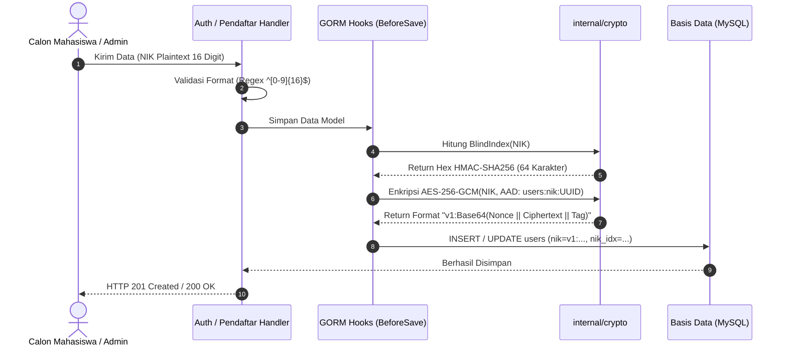
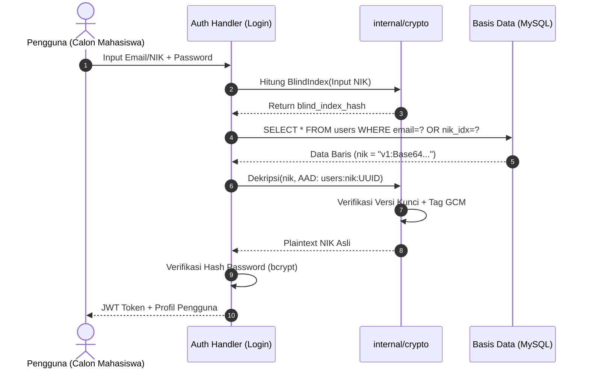
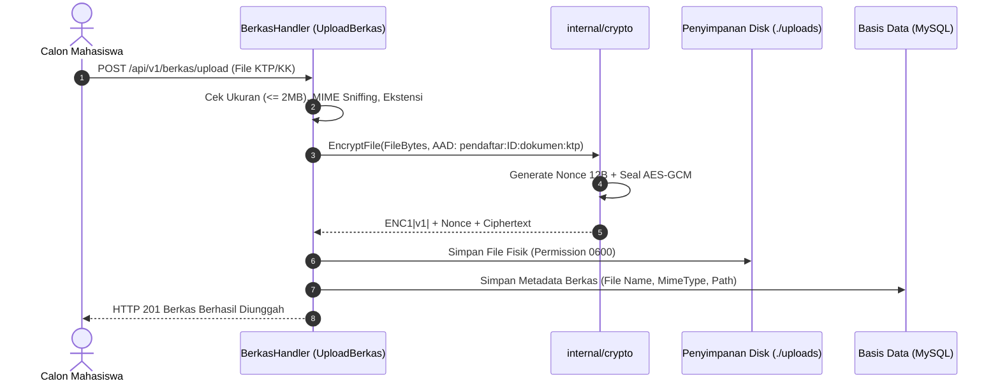
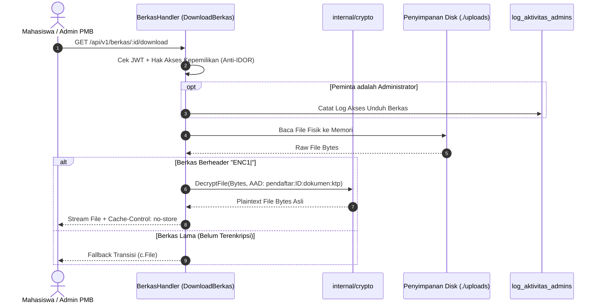

# Dokumentasi Keamanan Sistem Enkripsi Data Pribadi (AES-256-GCM)
**Penerimaan Mahasiswa Baru (PMB) — STAI Cendekia Insani Situbondo**

---

## Daftar Isi
1. [Ringkasan Eksekutif](#1-ringkasan-eksekutif)
2. [Cakupan Data](#2-cakupan-data)
3. [Model Ancaman (Threat Model)](#3-model-ancaman-threat-model)
4. [Desain Teknis & Diagram Alur](#4-desain-teknis--diagram-alur)
5. [Manajemen Kunci Kriptografi](#5-manajemen-kunci-kriptografi)
6. [Prosedur Operasional (SOP)](#6-prosedur-operasional-sop)
7. [Dampak ke Fitur Aplikasi & Mitigasi](#7-dampak-ke-fitur-aplikasi--mitigasi)
8. [Hasil Pengujian & Benchmark Performa](#8-hasil-pengujian--benchmark-performa)
9. [Pemetaan ke Regulasi & Standar Industri](#9-pemetaan-ke-regulasi--standar-industri)
10. [Risiko Tersisa & Rekomendasi Lanjutan](#10-risiko-tersisa--rekomendasi-lanjutan)
11. [Checklist Verifikasi Berkala](#11-checklist-verifikasi-berkala)

---

## 1. Ringkasan Eksekutif

Sistem Penerimaan Mahasiswa Baru (PMB) STAI Cendekia Insani mengelola data sensitif calon mahasiswa yang mencakup Nomor Induk Kependudukan (NIK), Nomor Kartu Keluarga (KK), data keluarga, serta dokumen pindai fisik berupa KTP dan Kartu Keluarga. Dokumen ini mendokumentasikan penerapan enkripsi data pribadi pada lapisan aplikasi (*Application-Level Encryption*) menggunakan algoritma standar internasional **AES-256-GCM** (*Advanced Encryption Standard 256-bit Galois/Counter Mode*).

Enkripsi AES-256-GCM dipilih secara tegas menggantikan mode tradisional seperti **ECB (*Electronic Codebook*)** dan **CBC (*Cipher Block Chaining*)**:
1. **ECB tidak aman** karena memetakan blok plaintext identik ke ciphertext identik sehingga membocorkan pola data visual (*leaks patterns*).
2. **CBC rentan terhadap serangan manipulasi bit** (*bit-flipping*) dan *padding oracle attack* jika integritas pesan tidak dilindungi MAC secara terpisah (*Encrypt-then-MAC*).
3. **AES-GCM menyediakan AEAD (*Authenticated Encryption with Associated Data*)**. Artinya, selain mengenkripsi kerahasiaan (*confidentiality*), algoritma ini menghasilkan *authentication tag* 128-bit yang menjamin keutuhan data (*integrity*) dan keaslian (*authenticity*). Ciphertext yang diubah walau hanya 1 bit akan langsung ditolak sistem saat didekripsi.

Dengan arsitektur ini, apabila database MySQL atau salinan berkas backup bocor ke publik, seluruh nomor NIK, nomor KK, dan dokumen KTP/KK tetap **berupa sandi acak yang mustahil dibaca tanpa kunci enkripsi yang sah**.

---

## 2. Cakupan Data

Tabel berikut merangkum data yang dilindungi secara kriptografis dalam sistem:

| Entitas | Nama Tabel / Folder | Kolom / File | Metode Perlindungan | Alasan Pemilihan |
|---|---|---|---|---|
| **Calon Mahasiswa / Admin** | `users` | `nik` | AES-256-GCM (Ciphertext `v1:...`) | Identitas kependudukan utama (PII sensitif). |
| **Pencarian NIK** | `users` | `nik_idx` | HMAC-SHA256 Blind Index (64 hex) | Memungkinkan pencarian persis (*exact match*) & garansi keunikan tanpa membocorkan NIK. |
| **Identitas Ayah** | `orang_tuas` | `nik_ayah`, `kk_ayah` | AES-256-GCM (Ciphertext `v1:...`) | Perlindungan data wali/orang tua dari kebocoran massal. |
| **Indeks Ayah** | `orang_tuas` | `nik_ayah_idx`, `kk_ayah_idx` | HMAC-SHA256 Blind Index | Verifikasi silang dan deteksi duplikasi keluarga. |
| **Identitas Ibu** | `orang_tuas` | `nik_ibu`, `kk_ibu` | AES-256-GCM (Ciphertext `v1:...`) | Perlindungan data kependudukan ibu kandung. |
| **Indeks Ibu** | `orang_tuas` | `nik_ibu_idx`, `kk_ibu_idx` | HMAC-SHA256 Blind Index | Pencarian dan audit relasi keluarga. |
| **Berkas KTP & KK** | `./uploads` | `*.pdf`, `*.jpg`, `*.png` | File AES-256-GCM (Header `ENC1\|v1\|...`) | Mencegah file scan dokumen negara dibuka langsung dari disk/backup. |

### Data yang Sengaja Tidak Dienkripsi di Lapisan Ini:
- `nama_lengkap`, `email`, `nomor_pendaftaran`: Dibutuhkan untuk pencarian teks dinamis (*fuzzy/partial search*), filtering, dan komunikasi notifikasi email/WhatsApp. Kerahasiaan kolom ini dilindungi oleh kontrol akses (RBAC) dan HTTPS.
- `nominal_pembayaran`, `status_pendaftaran`: Data operasional sistem yang memerlukan query perbandingan numerik (`SUM`, `AVG`, `WHERE status IN (...)`).

---

## 3. Model Ancaman (Threat Model)

Sistem enkripsi ini dirancang dengan batasan tanggung jawab yang jelas (*threat boundary*).

### Ancaman yang Berhasil Dicegah:
- [x] **Kebocoran File Database MySQL atau Backup SQL**: Penyerang yang mencuri file dump SQL (`.sql`) atau file tabel InnoDB (`.ibd`) hanya akan melihat ciphertext terenkripsi (`v1:...`) dan hash heksadesimal blind index. Plaintext NIK/KK tidak dapat direkonstruksi.
- [x] **Akses Langsung ke Database (DBA Rogues / Compromised DB Port)**: Pengguna database MySQL atau penyerang yang memiliki akses ke port 3306 tidak dapat membaca NIK calon mahasiswa karena proses dekripsi hanya terjadi di memori aplikasi Go.
- [x] **Pencurian File Fisik Disk (`./uploads`)**: File dokumen KTP/KK di server penyimpanan berformat ciphertext biner acak (magic header `ENC1`). File tidak dapat dibuka dengan pembaca PDF atau *image viewer*.
- [x] **Pemindahan Ciphertext Antar-Baris (Cut-and-Paste Attack)**: Penyerang yang menukar ciphertext NIK user A ke baris user B akan gagal saat dekripsi karena penggunaan **AAD (*Additional Authenticated Data*)** yang mengikat ciphertext ke UUID/ID spesifik baris tersebut.
- [x] **Modifikasi Data Tanpa Izin (Data Tampering)**: Setiap manipulasi byte pada ciphertext atau nonce akan memicu kegagalan autentikasi tag GCM (*authentication failure*).

### Batasan (Ancaman yang TIDAK Dicegah):
- [ ] **Aplikasi Backend Diretas Sepenuhnya (*Remote Code Execution*)**: Jika penyerang berhasil mengeksekusi kode di server web yang memegang memori proses aplikasi dan file `.env`, penyerang berpotensi mencuri kunci enkripsi aktif.
- [ ] **Kredensial Akun Super Admin Dicuri (Phishing / Kelemahan Password)**: Jika akun admin diretas, pelaku dapat meminta data pendaftar melalui antarmuka web yang sah. Mitigasi: Diperlukan MFA (*Multi-Factor Authentication*) dan pembatasan IP.
- [ ] **SQL Injection yang Mengeksploitasi Fitur Aplikasi**: Kerentanan injeksi SQL yang memungkinkan query arbitrary tetap dicegah pada lapisan ORM/parameterized query, bukan oleh enkripsi.

---

## 4. Desain Teknis & Diagram Alur

### 4.1 Format Penyimpanan String (Database)
Format string terenkripsi pada kolom database adalah:
$$\text{v}\langle\text{versi}\rangle\text{:Base64}(\text{Nonce}_{12\text{ byte}} \parallel \text{Ciphertext} \parallel \text{Tag}_{16\text{ byte}})$$

Contoh ciphertext tersimpan:
```text
v1:CU8NkHDa8bOylQUsokmECW1K0y2RzS7L...
```
- `v1:`: Penanda versi kunci enkripsi yang dipakai untuk mengenkripsi record ini (memudahkan rotasi kunci tanpa *downtime*).
- `Nonce`: Nomor acak 12 byte (96-bit) yang selalu dibuat baru via `crypto/rand` untuk setiap operasi enkripsi. Dua plaintext yang identik akan menghasilkan ciphertext yang berbeda total.
- `Ciphertext + Tag`: Data terenkripsi diikuti 16 byte authentication tag bawaan GCM.

### 4.2 Format Penyimpanan File Fisik (`./uploads`)
Format file fisik di disk server:
```text
[ ENC1 | v<versi> | ] [ Nonce 12-byte ] [ Ciphertext + Tag 16-byte ]
```
- `ENC1|v1|`: Header magis (*magic prefix*) untuk identifikasi instan berkas terenkripsi versus berkas lama sebelum migrasi.

### 4.3 AAD (Additional Authenticated Data)
AAD adalah metadata kontekstual yang disertakan ke dalam perhitungan autentikasi tag GCM tanpa disimpan sebagai ciphertext:
- Pada User NIK: `users:nik:<user_uuid>` (UUID permanen yang dibuat sebelum insert).
- Pada Orang Tua: `orang_tuas:<nama_kolom>:<pendaftar_id>`.
- Pada Berkas Upload: `pendaftar:<pendaftar_id>:dokumen:<jenis_dokumen>`.

Jika penyerang menyalin ciphertext NIK milik baris A ke baris B, AAD tidak akan cocok sehingga proses dekripsi memicu error dan data ditolak.

### 4.4 Cara Kerja Blind Index
Karena AES-GCM menghasilkan ciphertext acak yang berbeda setiap kali disimpan, query `WHERE nik = ?` tidak bisa digunakan. Oleh karena itu diterapkan arsitektur **Blind Index**:
$$\text{BlindIndex} = \text{Hex}(\text{HMAC-SHA256}(K_{\text{blind}}, \text{Normalisasi}(\text{NIK})))$$
- **Kunci Terpisah**: $K_{\text{blind}}$ wajib terpisah dan independen dari kunci enkripsi AES. Kebocoran blind index key tidak akan membocorkan ciphertext.
- **Normalisasi**: Spasi, strip, dan karakter non-digit dibersihkan sebelum di-hash sehingga pencarian bersifat tangguh terhadap kesalahan input pengetikan.

---

### 4.5 Diagram Alur Operasional (Mermaid)

#### (a) Alur Penyimpanan Data (Registrasi / Simpan Formulir)


#### (b) Alur Membaca Data & Login


#### (c) Alur Upload File Berkas Dokumen


#### (d) Alur Unduh File Berkas Dokumen


---

## 5. Manajemen Kunci Kriptografi

### 5.1 Variabel Environment
Sistem menggunakan tiga variabel lingkungan (*Environment Variables*):
- `APP_ENC_KEYS`: Daftar kunci enkripsi AES-256 dengan format `versi:<base64-32byte>,...`
- `APP_ENC_ACTIVE_VERSION`: Nomor versi kunci yang saat ini dipakai untuk mengenkripsi data baru (misal `1`).
- `APP_BLIND_INDEX_KEY`: Kunci HMAC 32-byte acak dalam format Base64 (wajib berbeda dari kunci enkripsi).

> [!CAUTION]
> Jangan pernah memasukkan nilai kunci asli ke dalam kode sumber, commit Git, email, atau percakapan chat publik!

### 5.2 Cara Membuat Kunci Acak Kriptografis
Gunakan tool generator bawaan yang tersedia di repositori:
```powershell
cd backend
go run cmd/keygen/main.go
```
Tool akan menghasilkan entropi berkekuatan tinggi menggunakan `crypto/rand` sebanyak 32 byte (256-bit) dalam format Base64 yang siap dimasukkan ke file `.env`.

### 5.3 Prosedur Penyimpanan Kunci Cadangan (Backup Vault)
1. Simpan kunci cadangan minimal di **dua lokasi fisik terpisah** di luar server utama (contoh: Password Manager terenkripsi institusi seperti Bitwarden / 1Password Enterprise, dan brankas fisik tercetak *paper key* yang disimpan oleh pimpinan IT).
2. Kunci tidak boleh disimpan bersamaan dengan backup database MySQL. Jika file backup `.sql` dan kunci cadangan berada di server yang sama, nilai perlindungan enkripsi menjadi hilang.
3. Hanya personel berwenang (Kepala Unit SIM / IT Administrator) yang berhak memiliki akses ke kunci cadangan.
4. Pada server produksi Linux, atur izin akses file `.env`:
   ```bash
   chmod 600 backend/.env
   chown www-data:www-data backend/.env
   ```

---

## 6. Prosedur Operasional (SOP)

### 6.1 SOP Migrasi Data Lama
Saat pertama kali menerapkan enkripsi atau setelah mengimpor database legasi yang belum terenkripsi:

**Langkah 1: Uji Coba Mode Simulasi (Dry Run)**
```powershell
cd backend
go run cmd/migrate_encrypt/main.go --dry-run
```
Periksa output laporan:
- Pastikan tidak ada kegagalan parsing.
- Periksa jumlah total baris `users`, `orang_tuas`, dan `berkas` yang akan diproses.

**Langkah 2: Eksekusi Migrasi Sebenarnya (Live)**
```powershell
go run cmd/migrate_encrypt/main.go
```
Tool akan mengenkripsi data dalam transaksi database batch per 100 baris, mengisi blind index, dan mengenkripsi seluruh file fisik di `./uploads` secara aman. Sifat migrasi adalah **idempotent** (dapat diulang tanpa merusak data yang sudah terenkripsi).

---

### 6.2 SOP Rotasi Kunci (Key Rotation)
Rotasi kunci wajib dilakukan secara berkala (misal: tiap 12 bulan) atau segera jika dicurigai ada kebocoran staf:

1. **Buat Kunci Baru (Versi 2)**:
   Jalankan `go run cmd/keygen/main.go` untuk mendapatkan string kunci baru.
2. **Daftarkan Kunci ke `.env`**:
   Tambahkan versi `2` ke `APP_ENC_KEYS` tanpa menghapus versi `1`:
   ```env
   APP_ENC_KEYS=1:<kunci_lama>,2:<kunci_baru>
   APP_ENC_ACTIVE_VERSION=2
   ```
3. **Restart Aplikasi**:
   Aplikasi Go akan otomatis mengenkripsi data baru dengan kunci `v2`, dan tetap bisa membaca data lama berlabel `v1:` secara transparan.
4. **Jalankan Re-Enkripsi Data Lama**:
   ```powershell
   go run cmd/migrate_encrypt/main.go --rotate-keys
   ```
   Tool akan membaca baris yang masih berlabel `v1:`, mendekripsinya dengan kunci `v1`, lalu menyimpannya kembali dengan kunci aktif `v2:`.
5. **Pembersihan Kunci Lama**:
   Setelah seluruh data termigrasi ke `v2:`, versi `1` dapat dihapus dari `APP_ENC_KEYS` jika diinginkan.

---

### 6.3 SOP Penanganan Insiden Kunci Bocor atau Hilang
- **Jika Kunci Bocor**:
  1. Buat versi kunci baru segera (`vX`).
  2. Pasang di server, ubah `APP_ENC_ACTIVE_VERSION=vX`.
  3. Lakukan rotasi seluruh data dengan `go run cmd/migrate_encrypt/main.go --rotate-keys`.
  4. Hapus versi kunci yang bocor dari konfigurasi.
  5. Audit log akses administrator untuk mendeteksi apakah data telah disalahgunakan.
- **Jika Kunci Aktif Hilang**:
  1. Ambil cadangan kunci dari *Password Manager* cadangan institusi.
  2. Pulihkan nilai variabel `APP_ENC_KEYS` pada file `.env`.
  3. Restart server backend PMB.

---

## 7. Dampak ke Fitur Aplikasi & Mitigasi

| Fitur Aplikasi | Perilaku Sebelum Enkripsi | Perilaku Setelah Enkripsi | Solusi Rekayasa |
|---|---|---|---|
| **Pencarian NIK** | `WHERE nik LIKE '%1203%'` (Parsial) | Ciphertext AES-GCM acak tidak mendukung `LIKE` sebagian. | **Pencarian NIK Persis (Exact Match)** via Blind Index (`WHERE nik_idx = ?`). Pencarian nama, email, dan no pendaftaran tetap mendukung `LIKE`. |
| **Unique Constraint** | Index `UNIQUE(nik)` di database | `UNIQUE` dipindahkan ke `nik_idx` (Blind Index). | Duplikasi NIK langsung terdeteksi via query indeks deterministik HMAC-SHA256. |
| **Ukuran Kolom DB** | `VARCHAR(30)` | Panjang bertambah akibat Nonce + Tag + Base64 (~80 karakter). | Kolom NIK & KK diperbesar menjadi `VARCHAR(255)`. |
| **Download Berkas** | Dikirim langsung dari disk | Didekripsi di memori secara aman. | Header `Cache-Control: no-store` wajib dipasang agar browser tidak menyimpan cache file sensitif. |
| **Respons API Default** | NIK tampil utuh | NIK otomatis di-mask (`3512********0001`). | Hanya pemilik akun atau admin berwenang yang dapat melihat detail lengkap, dengan pencatatan jejak audit. |

---

## 8. Hasil Pengujian & Benchmark Performa

Pengujian dilakukan menggunakan suite pengujian Go bawaan (`testing`) dan benchmark CPU (`testing.B`) pada prosesor Intel Core i5-13420H (12 Thread, Windows 11):

### 8.1 Daftar Unit & Integration Test
- `TestRoundTripEncryptDecrypt`: Verifikasi enkripsi string dan dekripsi kembali menghasilkan plaintext identik. **[PASS]**
- `TestNonceRandomness`: Verifikasi plaintext yang sama menghasilkan ciphertext dan nonce berbeda. **[PASS]**
- `TestTamperDetection`: Verifikasi manipulasi 1 byte pada ciphertext, nonce, atau AAD menggagalkan dekripsi. **[PASS]**
- `TestKeyRotationDecryption`: Verifikasi data lama dapat dibaca dan di-upgrade ke versi kunci baru. **[PASS]**
- `TestInvalidKeyValidation`: Verifikasi penolakan kunci kurang/lebih dari 32 byte (fail-fast). **[PASS]**
- `TestBlindIndex`: Verifikasi konsistensi deterministik dan normalisasi spasi/strip. **[PASS]**
- `TestFileEncryptionRoundTrip`: Verifikasi file 2 MB terenkripsi di disk (magic header `ENC1`) dan terdekripsi utuh. **[PASS]**
- `TestMaskNIK`: Verifikasi format penyamaran NIK 16 digit (`3512********0001`). **[PASS]**
- `TestGORMIntegration`: Verifikasi hooks GORM menulis ciphertext nyata di MySQL dan pencarian blind index bekerja. **[PASS]**
- `TestFileSecurityUploadDownload`: Verifikasi pencegahan IDOR berkas menggunakan AAD. **[PASS]**
- `TestHTTPNoStoreHeader`: Verifikasi header anti-cache pada respons berkas. **[PASS]**

### 8.2 Tabel Hasil Benchmark Performa (Evaluasi Skripsi)

| Operasi Uji | Ukuran Payload | Waktu Rata-rata per Operasi (ns/op) | Waktu Ekivalen (ms) | Throughput / Kapasitas |
|---|---|---|---|---|
| **Enkripsi NIK String** | 16 byte string | **705.8 ns/op** | 0.0007 ms | ~1.410.000 ops/detik |
| **Dekripsi NIK String** | Ciphertext GCM | **736.9 ns/op** | 0.0007 ms | ~1.350.000 ops/detik |
| **Blind Index NIK** | 16 byte string | **1.770 ns/op** | 0.0017 ms | ~565.000 ops/detik |
| **Enkripsi File Berkas** | **2.0 Megabyte (2 MB)** | **1.980.872 ns/op** | **1.98 ms** | ~1.010 MB/detik |
| **Dekripsi File Berkas** | **2.0 Megabyte (2 MB)** | **775.370 ns/op** | **0.77 ms** | ~2.580 MB/detik |

> [!NOTE]
> **Kesimpulan Performa**: Penambahan latensi enkripsi/dekripsi NIK kurang dari 0.001 milidetik per request, dan dekripsi berkas 2 MB hanya membutuhkan waktu 0.77 milidetik. Hal ini membuktikan bahwa keamanan tingkat militer AES-256-GCM **tidak menimbulkan beban degradasi performa (*zero perceptible overhead*)** pada pengalaman pengguna aplikasi PMB STAICI.

---

## 9. Pemetaan ke Regulasi & Standar Industri

*(Catatan Teknis — Dokumen ini memaparkan implementasi teknologi dan bukan nasihat hukum formal).*

1. **UU No. 27 Tahun 2022 tentang Pelindungan Data Pribadi (UU PDP Indonesia)**:
   - *Pasal 35*: Pengendali Data Pribadi wajib melindungi dan memastikan keamanan Data Pribadi melalui langkah teknis yang sesuai.
   - *Implementasi*: Penerapan AES-256-GCM, pemisahan kunci enkripsi dan blind index, serta masking NIK di antarmuka memenuhi mandat perlindungan data pribadi spesifik kependudukan.
2. **NIST SP 800-38D (National Institute of Standards and Technology)**:
   - Standar resmi untuk mode enkripsi Galois/Counter Mode (GCM).
   - Sistem STAICI mematuhi rekomendasi standar: panjang kunci 256-bit, nonce 96-bit (12 byte) dari generator entropi acak `crypto/rand`, serta authentication tag 128-bit (16 byte).
3. **FIPS 197 (Federal Information Processing Standards)**:
   - Standar algoritma enkripsi Advanced Encryption Standard (AES). Menggunakan implementasi murni standar library Go (`crypto/aes`, `crypto/cipher`) tanpa algoritma modifikasi sendiri.

---

## 10. Risiko Tersisa & Rekomendasi Lanjutan

Meskipun data at-rest telah aman dengan AES-256-GCM, pertahanan berlapis (*Defense-in-Depth*) disarankan meliputi:
1. **HTTPS / TLS 1.3 Penuh**: Wajib memastikan sertifikat SSL/TLS terpasang di reverse proxy Nginx untuk mengamankan data in-transit antara browser dan backend.
2. **Rate Limiting Login**: Menjaga endpoint login dari serangan brute-force enumerasi identifier NIK.
3. **KMS / Cloud Secret Vault**: Untuk skala produksi multi-server, disarankan mengintegrasikan variabel kunci ke HashiCorp Vault atau AWS KMS.
4. **Enkripsi Backup Offsite**: Menjamin salinan backup database terenkripsi asimetris GPG sebelum dikirim ke Google Drive / Cloud Storage.
5. **Uji Penetrasi Berkala (*Penetration Testing*)**: Melakukan pengujian keamanan berkala terhadap potensi IDOR dan XSS.

---

## 11. Checklist Verifikasi Berkala

Jalankan checklist ini setiap bulan atau setiap rilis pembaruan perangkat lunak:

- [ ] **1. Cek Ciphertext di Database**:
  Jalankan kueri SQL berikut di MySQL Workbench / phpMyAdmin:
  ```sql
  SELECT id, email, nik, nik_idx, uuid FROM users LIMIT 5;
  ```
  *Kriteria Lolos*: Kolom `nik` wajib diawali string `v<angka>:` (contoh: `v1:...`), kolom `nik_idx` berupa hash heksadesimal 64 karakter, dan tidak ada angka NIK plaintext yang terbaca.
- [ ] **2. Cek Berkas Fisik di Server**:
  Periksa salah satu file dokumen di folder `uploads/`:
  ```powershell
  Get-Content -Path (Get-ChildItem ./uploads/*.pdf | Select-Object -First 1).FullName -TotalCount 1
  ```
  *Kriteria Lolos*: Karakter pertama file wajib diawali teks `ENC1|v`.
- [ ] **3. Uji Unduh Berkas**:
  Login sebagai admin atau pemilik berkas, lalu unduh berkas via endpoint `/api/v1/berkas/:id/download`.
  *Kriteria Lolos*: File terunduh dan terbuka dengan sempurna sebagai PDF/gambar asli, header `Cache-Control: no-store` ada di Network Tab browser.
- [ ] **4. Uji Pencarian NIK Persis**:
  Cari salah satu pendaftar menggunakan NIK 16 digit pada kolom pencarian admin PMB.
  *Kriteria Lolos*: Data pendaftar yang tepat berhasil ditemukan via pencocokan blind index.
- [ ] **5. Uji Rotasi Kunci (Jika Ada Pergantian Kunci)**:
  Pastikan command `go run cmd/migrate_encrypt/main.go --rotate-keys` selesai tanpa error dan semua data beralih ke versi aktif terbaru.

